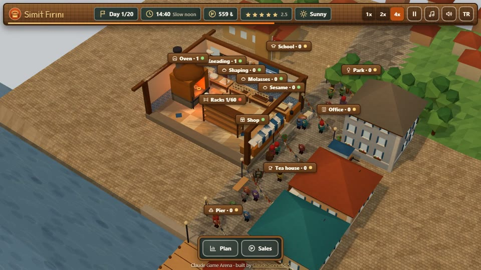
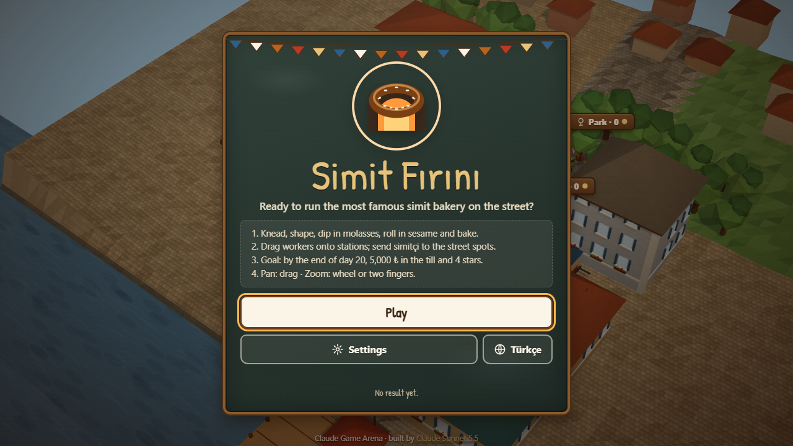
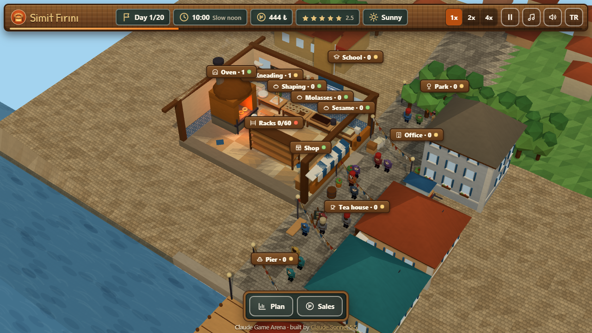
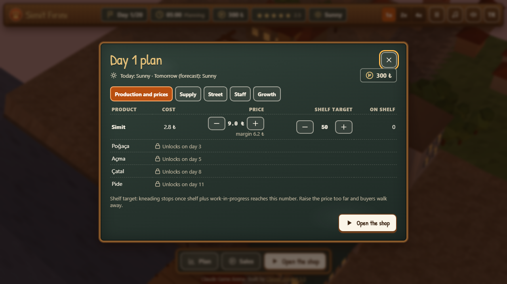
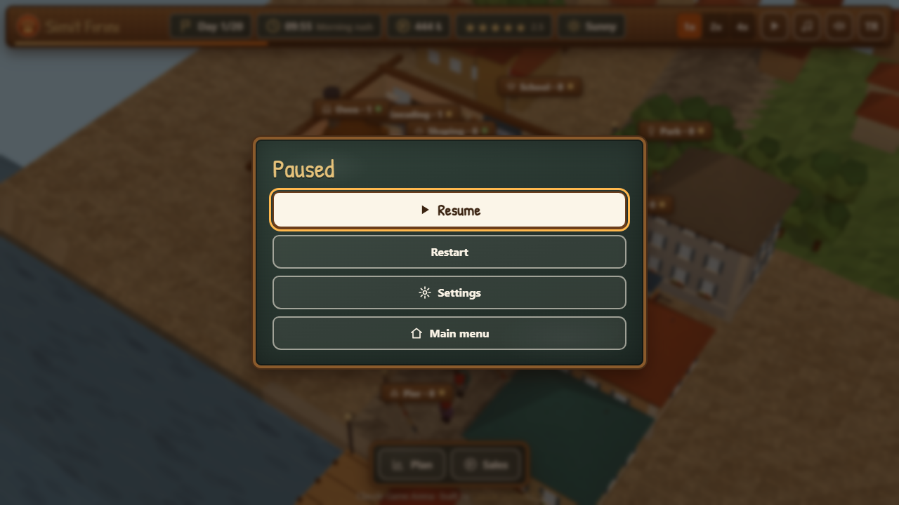
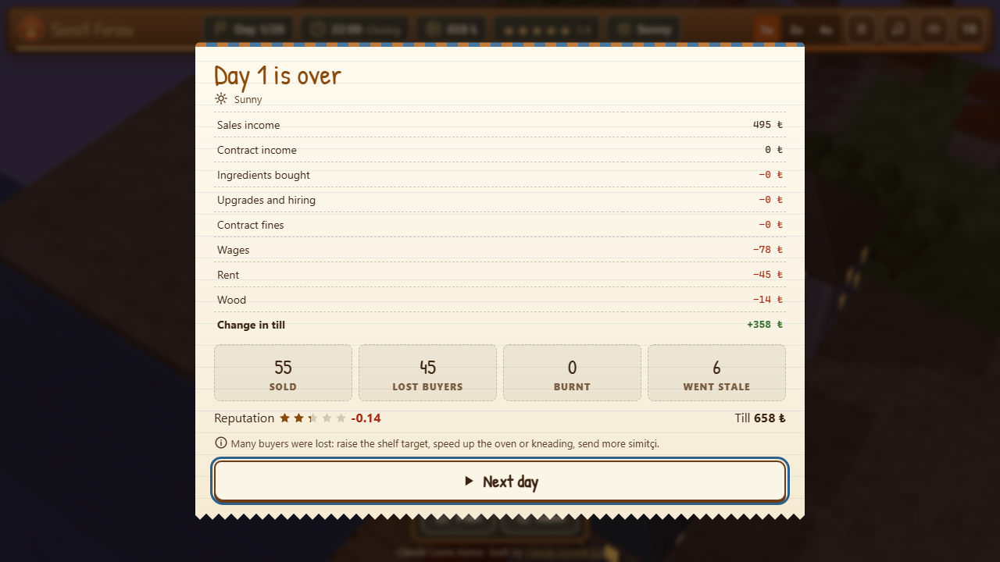
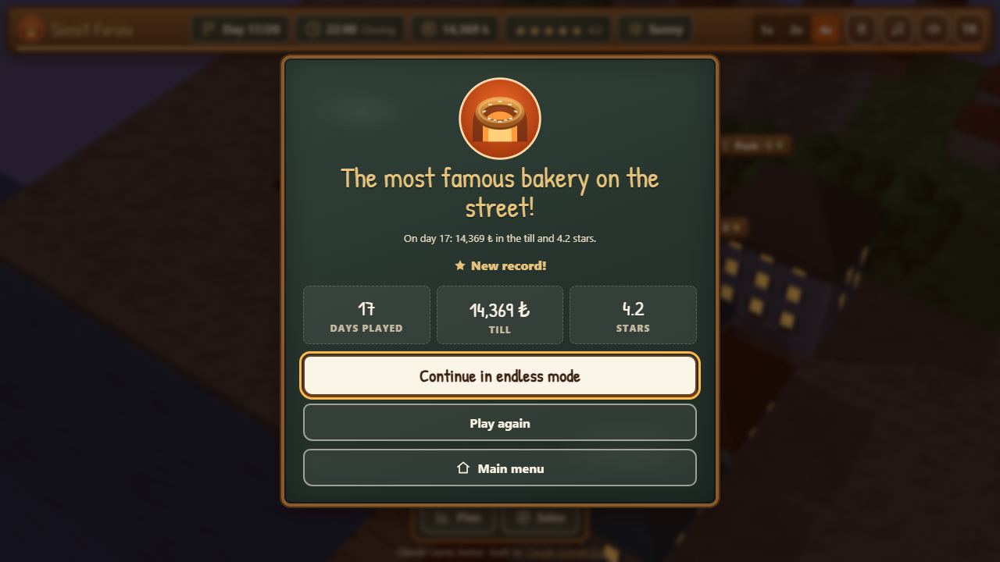
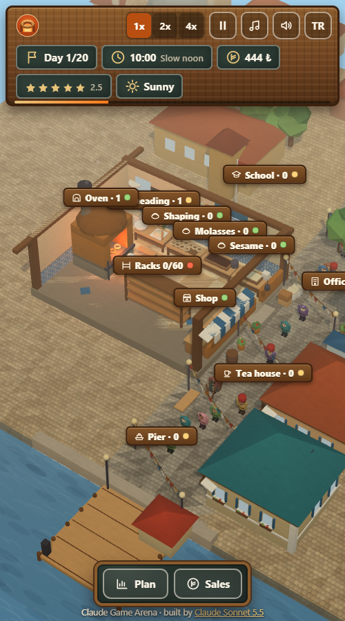
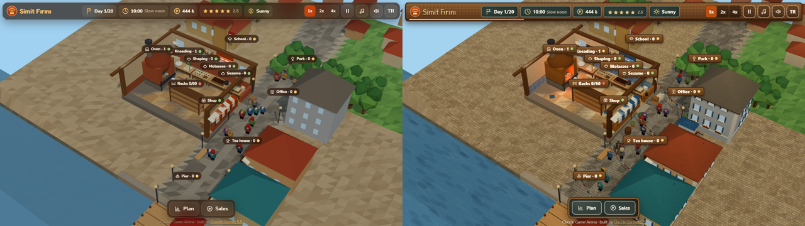

<p align="center">
  <a href="https://furkiozknn.github.io/simit-firini/">
    
  </a>
</p>

<p align="center">
  <a href="https://furkiozknn.github.io/simit-firini/"></a>
</p>

<p align="center">
  
  
  <a href="LICENSE"></a>
  
</p>

<!-- portals:start -->
<p align="center">
  Also on: <a href="https://furkiozknn.itch.io/simit-firini"><strong>itch.io</strong></a>
</p>
<!-- portals:end -->

<p align="center">
  <strong>A 3D simit bakery tycoon on an old Istanbul street: knead, shape, dip in molasses, roll in sesame and bake, then send simit sellers with trays to the pier, the school, the park, the office and the tea houses.</strong>
</p>

<!-- gameplay gif -->

## Features

- **Full bakery production chain:** Manage 5 distinct stations (kneading, shaping, molasses, sesame, oven) staffed by workers who gain skill; an unstaffed station runs at 30 % capacity with the owner filling in, but an unattended oven burns the bread.
- **Dynamic street selling:** Dispatch simit sellers (simitçi) carrying trays across 5 key spots (pier, school, park, office, tea houses); hourly sales and foot traffic shift dynamically with the hour and weather (rain empties the park and pier, cold fills the tea houses).
- **Daily strategy & expanding menu:** Plan morning production, set prices, order supplies, hire staff, buy upgrades, and take contracts to reach 5,000 lira and 4 stars of reputation by day 20, unlocking recipes for poğaça, açma, çatal, and pide.
- **Hands-on 3D management:** Drag workers between stations or out to street spots directly in the scene; click station labels to inspect real-time sales and demand charts, with speed controls at 1x, 2x, or 4x.
- **Ultra-lean web performance:** A single `index.html` running Three.js r170 delivering 60 fps at 20 &rarr; 28 draw calls (25.6k &rarr; 51.6k triangles) on Intel UHD 620, verified by an automated bot winning on day 17 with 0 JS errors (winning roughly 9 of 12 seeds between day 16 and 20; careless play bankrupt around day 7).

## How to play

> [!TIP]
> **Goal:** 5,000 lira in the till **and** 4 stars of reputation by day 20. Afterwards you can keep playing in endless mode.

1. **Plan the morning:** Before opening each morning, set production targets and retail prices, order flour and water from the supplier, assign workers to stations, and purchase equipment upgrades.
2. **Manage the bake:** Press **Open the shop** and staff all 5 stations (kneading, shaping, molasses, sesame, oven). Unstaffed stations drop to 30 % output as the owner covers, but an unattended oven burns the bread.
3. **Work the street:** Dispatch simitçi with trays to high-demand street spots (pier, school, park, office, tea houses). Adjust to weather and time of day, and restock trays before customer rushes pass.

<details>
<summary><b>Rules and economy</b></summary>

- **Production chain:** Mix flour and water, knead the dough, shape the rings, dip in molasses, roll in sesame, bake in the wood-fired oven, and stack on the racks.
- **Station staffing:** An unstaffed station runs at 30 % capacity (the owner fills in), but an unattended oven burns the bread.
- **Street sellers:** Simitçi carry trays to the pier, the school, the park, the office, and the tea houses, sell by the hour, and walk back to refill. Demand follows the hour and the weather.
- **Expenses & bankruptcy:** Wages, rent, and wood are paid every night. Drop below zero lira and the bakery goes bankrupt.
- **Menu unlocks:** New recipes unlock over time: poğaça, açma, çatal, and pide.
- **Endless mode:** Reach 5,000 lira and 4 stars of reputation by day 20 to win; continue playing afterwards in endless mode.

</details>

### Controls

| Action | Mouse / touch | Keyboard |
|---|---|---|
| Pan | Drag | Arrows / `WASD` |
| Zoom | Wheel / pinch | `+` / `-` |
| Open a station or spot panel | Click its label | |
| Move a worker | Drag worker onto station or street spot | |
| Speed 1x / 2x / 4x | Speed buttons | `1` `2` `3` |
| Pause / back | Pause button | `P` / `Esc` |
| Music / effects / language | HUD buttons | `M` / `X` / `L` |
| Fullscreen | Settings | `F` |

- **Global hotkeys:** `P` / `Esc` pause, `M` music, `X` effects, `L` language, `F` fullscreen, `1` `2` `3` speed.
- **Audio control:** HUD buttons toggle background music and sound effects independently.
- **Touch:** Drag to pan the scene, pinch to zoom, tap station or spot labels to view demand charts, and drag workers onto stations or street spots.
- **Persistence:** Settings (master / music / effects volume, language, Low / High quality tier) are saved in `localStorage` under `arena.simitfirini.settings`; the active run under `arena.simitfirini.save`, and the best result under `arena.simitfirini.best`. The language follows the browser (Turkish or English); small touch screens start on the Low tier.

<details>
<summary><b>URL flags for testing</b></summary>

| Flag | Effect |
|---|---|
| `?auto` | A bot plays to the end with the same rules as a player (4x speed) |
| `?debug` | FPS, draw calls, and JS errors on screen; `window.simitfiriniSim(seconds)` fast-forwards without rendering |
| `?sim=N` | Fast-forward N seconds before the first frame |
| `?low` | Low quality tier |
| `?lang=en` / `?lang=tr` | Start language |
| `?seed=N` | Fixed game seed |
| `?speed=N` | Game speed |
| `?noassets` | Accepted for the arena convention; the game uses no asset files anyway |

`window.simitfirini` exposes the live state.

</details>

## Screenshots

<table>
  <tr>
    <td width="33%"><br><sub>Title screen</sub></td>
    <td width="33%"><br><sub>The bakery and the street</sub></td>
    <td width="33%"><br><sub>Day plan: staff</sub></td>
  </tr>
  <tr>
    <td><br><sub>Pause menu</sub></td>
    <td><br><sub>End of day summary</sub></td>
    <td><br><sub>The most famous bakery on the street</sub></td>
  </tr>
</table>

<p align="center"><br><sub>On a phone</sub></p>

## Redesign & Performance

**Art direction:** A hand-painted 2.5D bakery. Palette: crust `#B5651D`, sesame `#E6C27A`, oven glow `#FF7A1A`, flour white `#FAF3E6`, tiled blue `#2C5F8A`. Wood-fired oven glow with flicker, steam and flour dust motes; menus are chalkboards, the day summary is a baker-paper receipt.

**Visual updates (rules, controls, bot, and saves are untouched):**
- **Scene:** Painted palette with warm lighting, cobblestone street and tiled bakery floor textures, props and dressed buildings, oven flame, steam, and flour FX.
- **Characters:** Animated bakers and customers with idle bobs walking the street and staffing stations.
- **UI:** Chalkboard modals with a self-hosted chalk font, title bunting, wooden top bar, receipt-style day summary; phone portrait and landscape layouts with verified touch modals.

**Measured on an Intel UHD 620 (headless Chrome, 1280x720):**
- Draw calls: 20 &rarr; 28
- Triangles: 25.6k &rarr; 51.6k
- Frame rate: 60 fps in gameplay before and after
- Phone layouts: Portrait and landscape checked in QA
- `?auto` bot wins on day 17 with 0 JS errors, with and without `?noassets`



## Running locally

Serve the folder over HTTP (ES modules do not load from `file://`):

```bash
python -m http.server 8000
```

Then open <http://localhost:8000/>.

## Made with Claude Code

Built by **Claude Sonnet 5.5** with Claude Code from one prompt: [prompts/simit-firini.md](prompts/simit-firini.md). Everything is generated in code: the cut-away bakery, the street, the workers and customers, the textures, the music, and the sound effects. No third-party asset files are used; Three.js is loaded from jsDelivr under its MIT licence, and Patrick Hand font subsets are self-hosted under OFL 1.1, see [CREDITS.md](CREDITS.md).

<details>
<summary><b>Technical notes</b></summary>

- **Simulation & economy (`DATA` table):** All recipes, prices, demand curves, and upgrade costs are contained in the `DATA` table inside `index.html`. A sensible bot wins in roughly 9 of 12 seeds (between day 16 and 20); a careless one goes bankrupt around day 7.
- **Rendering:** Three.js r170 with warm directional lighting, soft shadows, painted palettes, cobblestone street, tiled floor, wood-fired oven glow with flicker, steam, and flour dust motes.
- **Audio (Web Audio API):** Synthesized sound effects including oven crackle, dough slaps, simitçi calls, street chatter, rain, and a cheerful clarinet-and-darbuka music loop.
- **Typography:** Self-hosted Patrick Hand woff2 font subsets in `assets/fonts/` for chalkboard menus and in-world signs; system font stack for body text.

</details>

### Claude Game Arena

Simit Fırını is part of the **Claude Game Arena** series, where each game is built by a Claude model from one prompt.

[Hisar](https://furkiozknn.github.io/kale-savunmasi/) · [Çay Ocağı](https://furkiozknn.github.io/cay-ocagi/) · [Çini Ustası](https://furkiozknn.github.io/cini-ustasi/) · [Martı](https://furkiozknn.github.io/marti/) · [Kervan](https://furkiozknn.github.io/kervan/) · [Dolmuş](https://furkiozknn.github.io/dolmus/) · [Peri Golf](https://furkiozknn.github.io/peri-golf/) · [Mehter](https://furkiozknn.github.io/mehter/) · [Boğaz Vapuru](https://furkiozknn.github.io/bogaz-vapuru/) · [Karagöz](https://furkiozknn.github.io/karagoz/) · [Lale Bahçesi](https://furkiozknn.github.io/lale-bahcesi/)

**Round 5:** [Kapadokya Balonu](https://furkiozknn.github.io/kapadokya-balonu/) · [Ebru](https://furkiozknn.github.io/ebru/) · [Kırkpınar](https://furkiozknn.github.io/kirkpinar/) · [Çarşı Kaçışı](https://furkiozknn.github.io/carsi-kacisi/)

**Round 6:** [Topkapı Gecesi](https://furkiozknn.github.io/topkapi-gecesi/) · [Hamsi](https://furkiozknn.github.io/hamsi/) · [Pamukkale](https://furkiozknn.github.io/pamukkale/) · [Mimar Sinan](https://furkiozknn.github.io/mimar-sinan/)

## License

MIT, see [LICENSE](LICENSE).

Like the game? You can support new rounds on [Buy Me a Coffee](https://buymeacoffee.com/furkiozkann). The game stays free.
