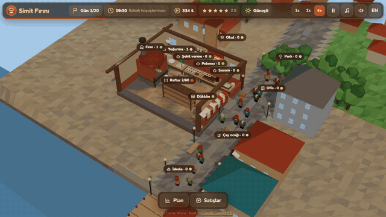
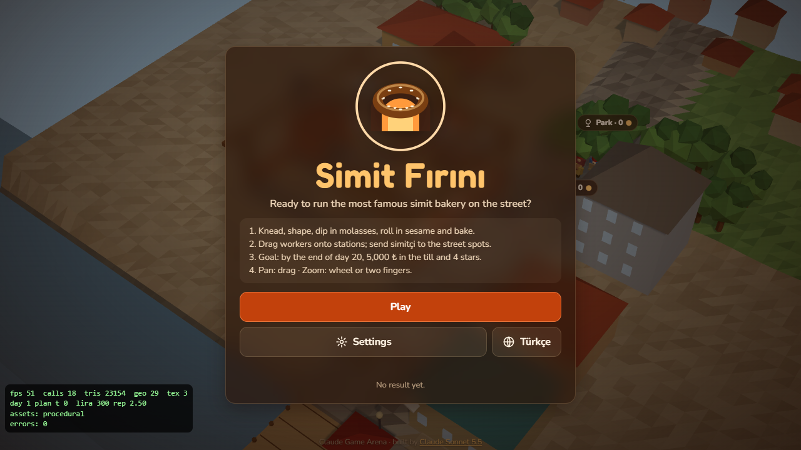
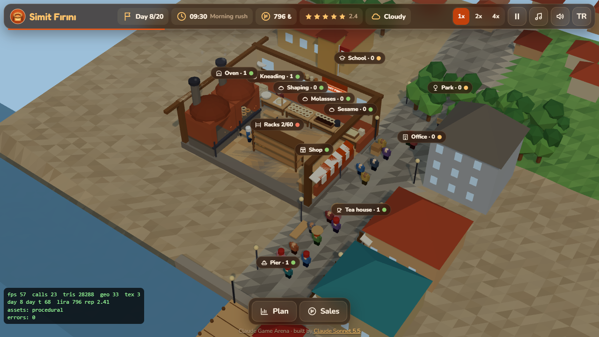
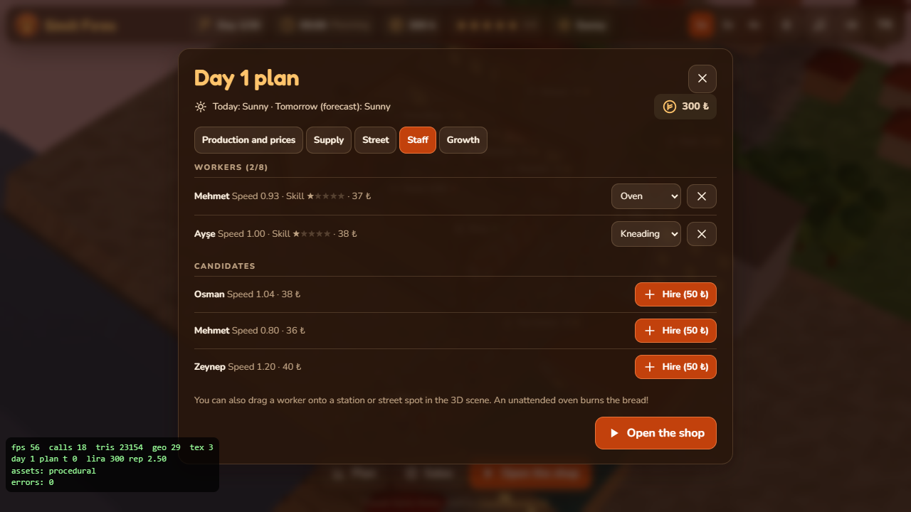
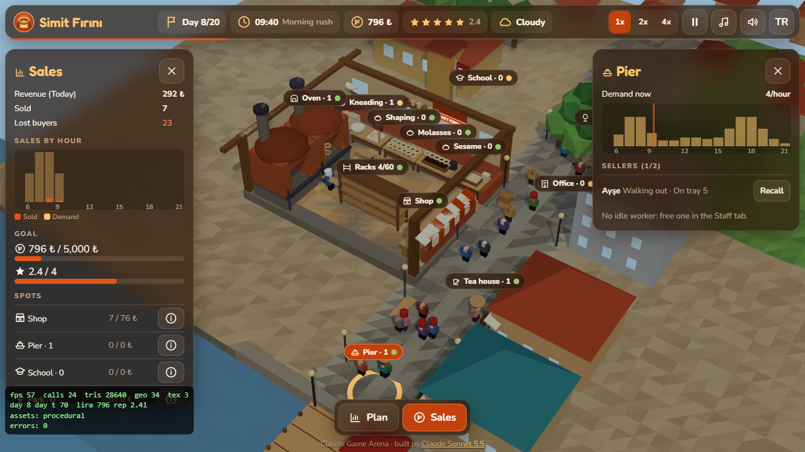
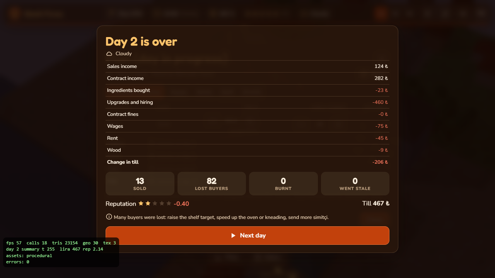
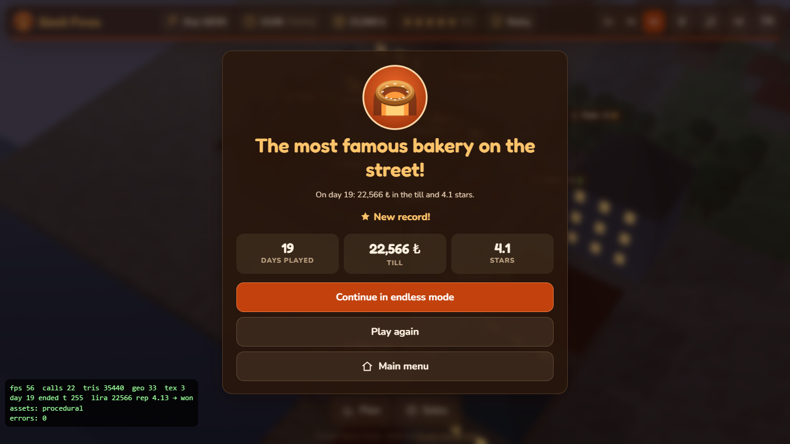
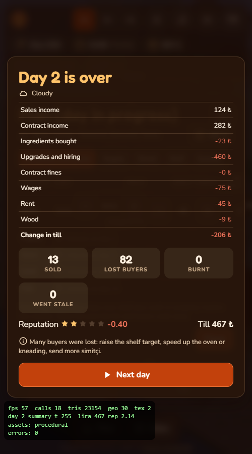

<p align="center">
  <a href="https://furkiozknn.github.io/simit-firini/"></a>
</p>

<p align="center">
  <a href="https://furkiozknn.github.io/simit-firini/"></a>
  
  
  <a href="LICENSE"></a>
  
</p>

<p align="center"><b>A 3D simit bakery tycoon on an old Istanbul street: knead, shape, dip in molasses, roll in sesame and bake, then send simit sellers with trays to the pier, the school, the park, the office and the tea houses.</b></p>

<p align="center">
  
</p>

<p align="center"><b>Play online: <a href="https://furkiozknn.github.io/simit-firini/">https://furkiozknn.github.io/simit-firini/</a></b> (desktop and phone, no install)</p>

## Highlights

- **A full production chain.** Five stations (kneading, shaping, molasses, sesame, oven) staffed by workers who gain
  skill; an unstaffed station runs at 30 % because the owner fills in, but an unattended oven burns the bread.
- **Simit sellers on the street.** Simitçi carry trays to street spots, sell by the hour and walk back to refill; demand
  follows the hour and the weather (rain empties the park and the pier, cold fills the tea houses).
- **Plan the day, then open the shop.** Set production targets and prices, order ingredients, hire staff, buy upgrades
  and take contracts before each day.
- **More than simit.** Poğaça, açma, çatal and pide unlock over time.
- **Hands on in 3D.** Drag a worker onto a station or a street spot in the scene; click a label to open its panel with
  sales and demand charts.
- **Balanced by a bot.** A sensible bot wins in roughly 9 of 12 seeds (between day 16 and 20); a careless one goes
  bankrupt around day 7.
- **One file, made in code.** One `index.html` with Three.js r170 from a CDN; geometry, textures, music and sound
  effects are all generated in code.

## How to play

> [!TIP]
> **Goal:** 5,000 lira in the till **and** 4 stars of reputation by day 20. Afterwards you can keep playing in endless
> mode.

Each morning, plan the day (production and prices, supply, street, staff, growth), then press **Open the shop**. Staff
the stations, keep an eye on the oven and send simitçi out to the street spots where the demand is.

<details>
<summary><b>More rules</b></summary>

- Production chain: flour and water, knead the dough, shape the rings, dip in molasses, roll in sesame, bake, racks.
- An unstaffed station runs at 30 % (the owner fills in), but an unattended oven burns the bread.
- Simitçi carry trays to the pier, the school, the park, the office and the tea houses, sell by the hour and walk back
  to refill. Demand follows the hour and the weather.
- Wages, rent and wood are paid at night. Go below zero and you are bankrupt.
- Recipes unlock over time: poğaça, açma, çatal, pide.

</details>

### Controls

| Action | Mouse / touch | Keyboard |
|---|---|---|
| Pan | drag | arrows / `WASD` |
| Zoom | wheel / pinch | `+` / `-` |
| Open a station or spot panel | click its label | |
| Move a worker | drag the worker onto a station or street spot | |
| Speed 1x / 2x / 4x | speed buttons | `1` `2` `3` |
| Pause / back | pause button | `P` / `Esc` |
| Music / effects / language | HUD buttons | `M` / `X` / `L` |
| Fullscreen | settings | `F` |

Settings are saved in `localStorage` under `arena.simitfirini.settings`; the run under `arena.simitfirini.save`, the
best result under `arena.simitfirini.best`. The language follows the browser (Turkish or English); small touch screens
start on the Low tier.

<details>
<summary><b>URL flags for testing</b></summary>

| Flag | Effect |
|---|---|
| `?auto` | a bot plays to the end with the same rules as a player (4x speed) |
| `?debug` | fps, draw calls and JS errors on screen; `window.simitfiriniSim(seconds)` fast-forwards without rendering |
| `?sim=N` | fast-forward N seconds before the first frame |
| `?low` | Low quality tier |
| `?lang=en` / `?lang=tr` | language |
| `?seed=N` | fixed game seed |
| `?speed=N` | game speed |
| `?noassets` | accepted; the game uses no asset files |

The live state is on `window.simitfirini`.

</details>

## Screenshots

<table>
  <tr>
    <td width="33%"><br><sub>Title screen</sub></td>
    <td width="33%"><br><sub>The bakery and the street</sub></td>
    <td width="33%"><br><sub>Day plan: staff</sub></td>
  </tr>
  <tr>
    <td><br><sub>Sales and pier demand</sub></td>
    <td><br><sub>End of day summary</sub></td>
    <td><br><sub>The most famous bakery on the street</sub></td>
  </tr>
</table>

<p align="center"><br><sub>On a phone</sub></p>

## Balance

All recipes, prices, demand curves and upgrade costs are in the `DATA` table inside `index.html`. A sensible bot wins in
roughly 9 of 12 seeds (between day 16 and 20); a careless one goes bankrupt around day 7.

## Running locally

Serve the folder over HTTP:

```
python -m http.server 8000
```

then open <http://localhost:8000/>.

## How it was made

Built by **Claude Sonnet 5.5** with Claude Code from one prompt: [prompts/simit-firini.md](prompts/simit-firini.md).
Everything is generated in code: the cut-away bakery, the street, the workers and customers, the textures, the music and
the sound effects. No asset files are used; Three.js and the Fredoka and Nunito fonts load from CDNs, see
[CREDITS.md](CREDITS.md).

Simit Fırını is part of the **Claude Game Arena** series, where each game is built by a Claude model from one prompt.
The other games: [Hisar](https://furkiozknn.github.io/kale-savunmasi/) ·
[Çay Ocağı](https://furkiozknn.github.io/cay-ocagi/) · [Çini Ustası](https://furkiozknn.github.io/cini-ustasi/) ·
[Martı](https://furkiozknn.github.io/marti/) · [Kervan](https://furkiozknn.github.io/kervan/) ·
[Dolmuş](https://furkiozknn.github.io/dolmus/) · [Peri Golf](https://furkiozknn.github.io/peri-golf/) ·
[Mehter](https://furkiozknn.github.io/mehter/) · [Boğaz Vapuru](https://furkiozknn.github.io/bogaz-vapuru/) ·
[Karagöz](https://furkiozknn.github.io/karagoz/) · [Lale Bahçesi](https://furkiozknn.github.io/lale-bahcesi/)

## Türkçe

**Simit Fırını**, eski bir İstanbul sokağında geçen 3D simit fırını işletme oyunu. Hamuru yoğur, şekil ver, pekmeze
batır, susama bula ve fırınla; simitçileri tablayla iskeleye, okula, parka, ofise ve çay ocaklarına gönder. Hedef 20.
güne kadar kasada 5.000 lira ve 4 yıldız itibar; sonra sonsuz mod. Kurulum yok; masaüstünde ve telefonda tarayıcıda
oynanır. Claude Sonnet 5.5 tarafından Claude Code ile tek bir prompt'tan yapıldı.

**Oyna:** https://furkiozknn.github.io/simit-firini/

## License

MIT, see [LICENSE](LICENSE).
